<p align="center">
  
</p>

<h1 align="center">Dymuse</h1>

**网易云音乐在各个平台上的客户端界面都他妈太丑了，所以就有了Dymuse。**

按 Apple 的设计规范重新做了界面：玻璃质感的迷你播放器与导航、顺滑的返回手势和转场、跟随系统的深浅色，用起来就像Apple Music。Android 版沿用同一套界面（玻璃效果为适应 Android 的 GPU 做了简化：保留半透明与高光，去掉了背后的实时模糊）。

同时也支持哔哩哔哩，把 B 站的合集和视频当作歌单来听。

没有中心服务器，所有账号、歌单和进度只保存在你自己的设备上；需要多设备同步时，可以用自己的 WebDAV；想和家人朋友共用一个会员账号取歌曲链接，可以自己部署一个很小的[取链服务](#部署取链服务可选多人共享一个会员账号)。

> Every official NetEase Cloud Music client looks ugly, so this is a Liquid Glass client for iOS, macOS and Android, with Bilibili as a second source. No server: everything stays on your device, and optional sync goes through your own WebDAV, and an optional self-hosted link service lets a few people share one member account for fetching song links.

## 截图

**iPhone**

<table>
  <tr>
    <td align="center">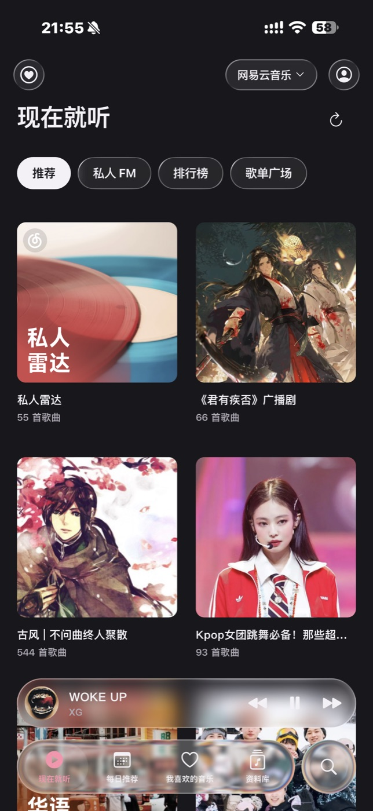<br>网易云 · 现在就听</td>
    <td align="center">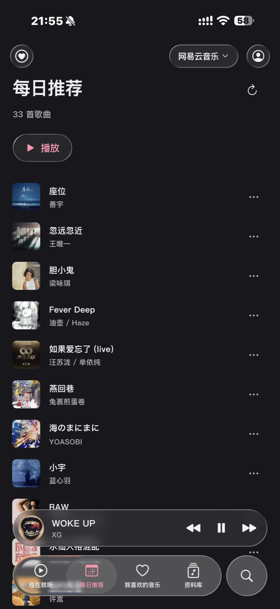<br>网易云 · 每日推荐</td>
    <td align="center">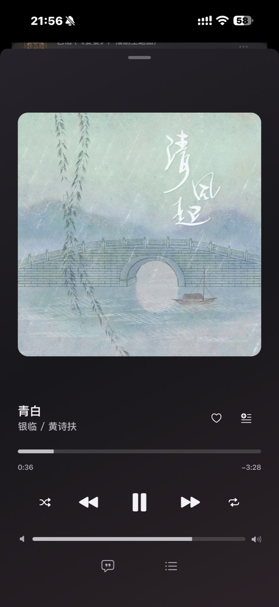<br>播放界面</td>
  </tr>
  <tr>
    <td align="center">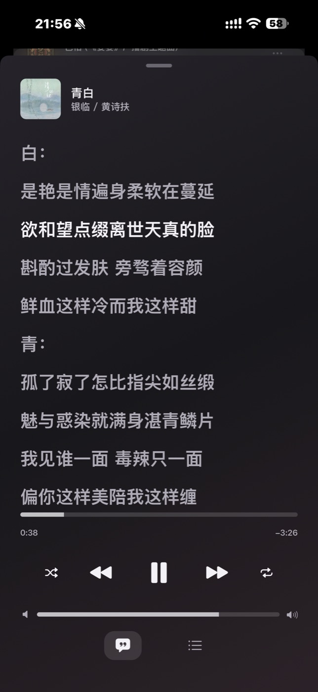<br>歌词</td>
    <td align="center">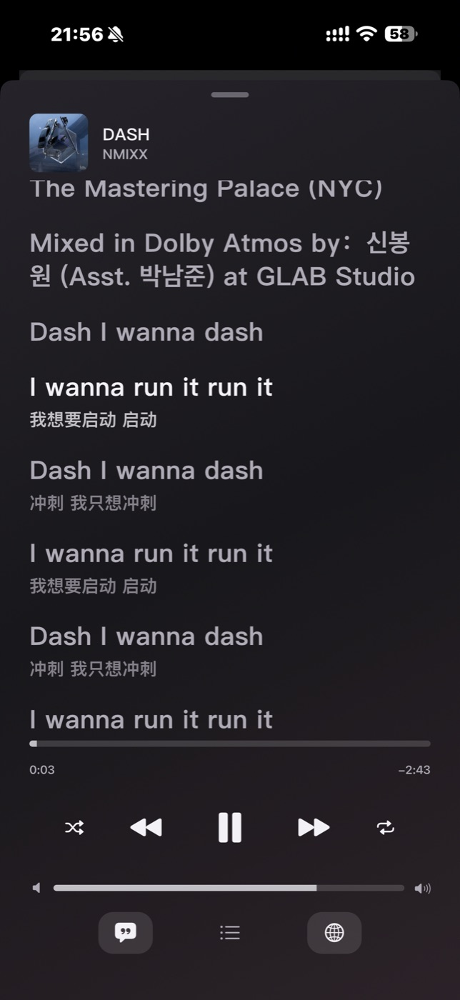<br>歌词 + 翻译</td>
    <td align="center">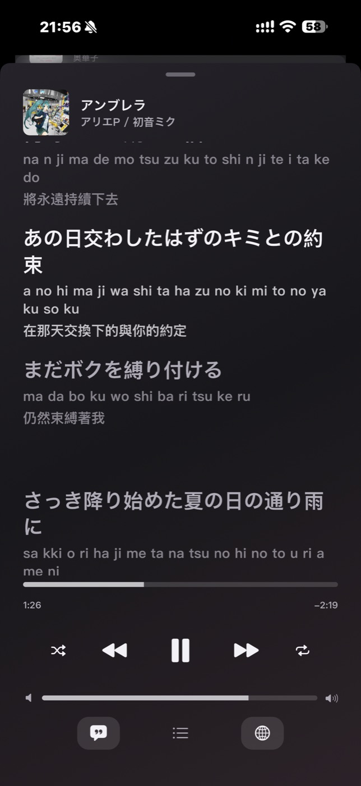<br>歌词 + 罗马音与翻译</td>
  </tr>
  <tr>
    <td align="center">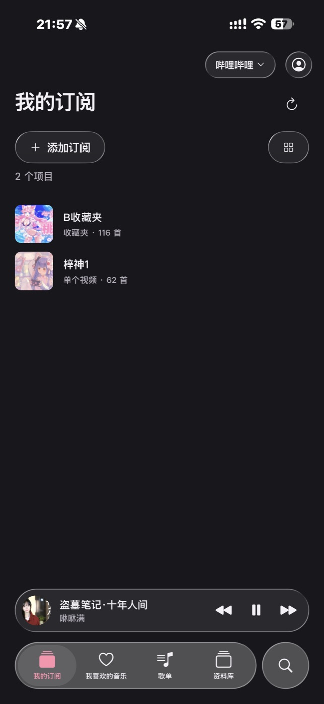<br>哔哩哔哩 · 我的订阅</td>
    <td align="center">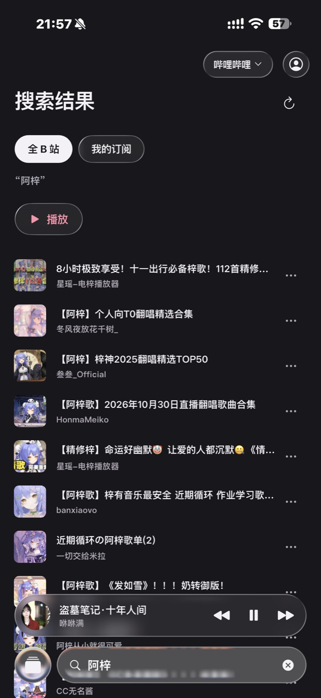<br>哔哩哔哩 · 搜索</td>
    <td align="center">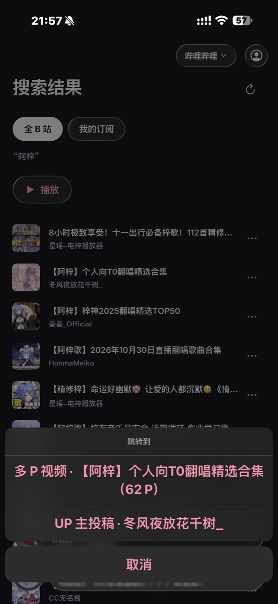<br>从搜索结果跳转到来源</td>
  </tr>
  <tr>
    <td align="center">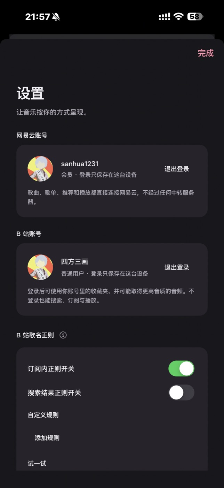<br>账号与设置</td>
    <td></td>
    <td></td>
  </tr>
</table>

**macOS**

<p align="center">
  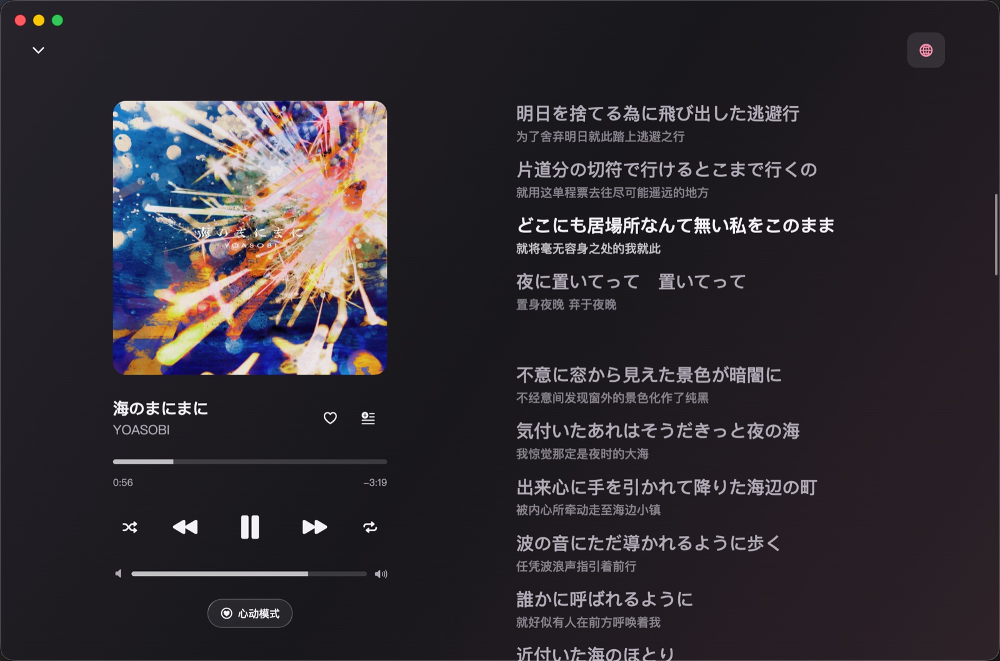
  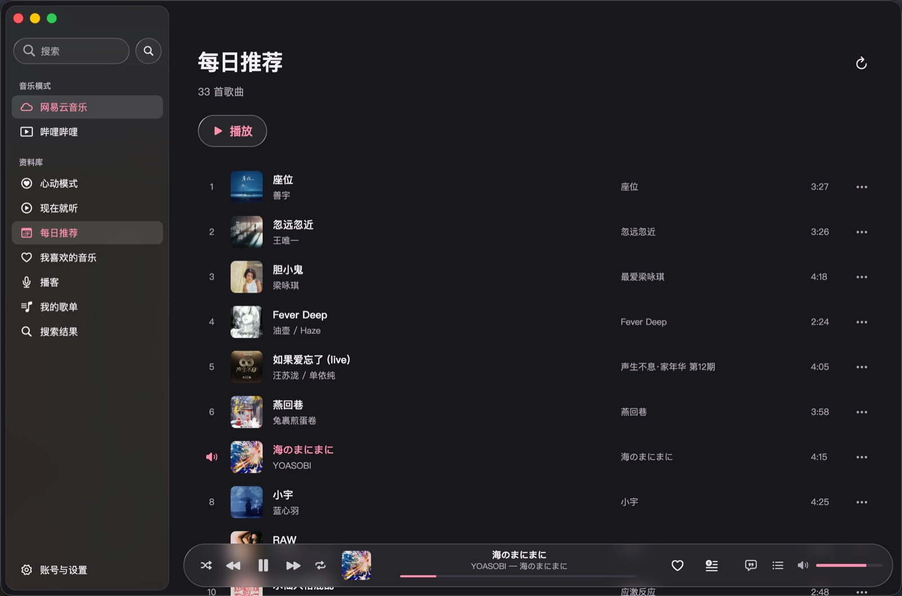
</p>

## 功能

**网易云模式**
- 扫码登录，推荐、搜索、歌单、专辑、艺人、播客、私人 FM、心动模式
- 也可以先不登录（游客）：搜索、浏览、播放、歌词、排行榜、每日推荐、推荐歌单、私人 FM 都能用；红心、我的歌单、心动模式、收藏歌单、播客订阅需要登录网易云账号，点进去会提示并可直接跳转登录。游客没有会员权益，会员歌曲只能试听，配合下面的取链服务才能完整播放
- 音质可选（标准到 Hi-Res），按歌曲实际提供的档位自动降档
- 歌词，支持翻译与罗马音，可任意组合显示
- 收藏歌单、红心、听歌记录
- 总之除了评论和广告，官方有的基本上全都有，没有的再说吧

**哔哩哔哩模式**

- 搜索全站，或只在已订阅的内容里按原视频名搜索
- 订阅合集、系列、收藏夹、订阅的合集、UP 主投稿、单个视频；可从视频一键跳转到所属合集、多 P 视频或 UP 主并订阅
- 歌名识别：从花哨的标题里提取真正的歌名，内置规则加自定义正则，订阅内与搜索结果可分别开关，随时可查看原视频名
- 本地歌单与红心
- 理论上你自己维护一个收藏夹然后订阅，就能无视所有版权限制，整个b站都是你的曲库（

**通用**

- 两种模式的歌单、队列、播放进度互相独立
- 可选 WebDAV 同步：红心、歌单、订阅、播放进度、设置，可选加密登录凭证；服务器上不会被覆盖或损坏
- 可选「取链服务」：自己部署一个小服务，让家人朋友共用同一个网易云会员账号取歌曲链接，各自的红心和歌单仍是自己的账号（见下方部署教程）
- 迷你播放器、锁屏与控制中心（Android 为通知栏与锁屏控制）、媒体键与耳机键、后台播放
- 主题色可选预设或手动取色
- WebDav仅作同步用途，且有自定义加密密钥，不用担心WebDav服务商窃取你的平台oauth
- 如果没有自建的WebDav，大陆环境推荐坚果云。小白可以参考这个教程：https://www.bilibili.com/video/BV1xf4y187Cy/?spm_id_from=333.337.search-card.all.click&vd_source=9d892c79bec4fcbaca00cfd4028700e4

## 更新记录

### 0.2.1

**新功能**

- **启动时检查更新**：全平台打开后自动检查新版本，可选“忽略此版本”或“更新”；Windows 绿色版可在应用内下载并原地更新，Android 可在应用内下载并调用系统安装器，macOS 下载后会弹出安装窗口并自动退出应用，把新版拖进「应用程序」替换即可（首次打开若被系统拦下，到“隐私与安全性”点“仍要打开”），iOS 提示后可选择去 Gitee 或 GitHub 下载。国内默认走 Gitee 镜像，设置里可改为优先 GitHub，也可手动检查。
- **登录改版**：首次打开的欢迎页提供“登录网易云账号 / 不登录，直接使用 / 从 WebDAV 同步数据”；网易云登录支持扫码、手机号+密码、手机号+验证码，遇到风控会提示验证；设置里的登录是可返回的独立页面，不登录也能继续使用。
- **Windows 版**：新增 Windows 桌面端（绿色版，解压即用）。

**界面**

- 系统字体放大到很大时，文字最多放大到 1.6 倍，底部标签文字保留；“我喜欢的音乐”统一改名为“我喜欢”。

### 0.2.0

**新功能**

- **取链服务**（可选）：自己部署一个很小的服务，让家人朋友共用一个网易云会员账号取歌曲链接，部署方法见[下方教程](#部署取链服务可选多人共享一个会员账号)。App 里可以随时开关；关闭后取链用自己登录的账号。取链服务的配置也会通过 WebDAV 加密同步到其他设备。
- **游客模式**：不登录网易云账号也能进入、播放和搜索；需要登录的功能不会隐藏，点进去会提示“请登录网易云账号之后使用这些功能”，并可以直接跳转登录。
- **macOS 菜单栏模式**：设置里可选关闭窗口后只在菜单栏显示，点图标重新打开。
- **网易云歌曲“···”菜单增加“跳转到…”**：可以跳转到专辑或任意一位歌手的主页。
- **迷你播放器进度条**（手机）：在迷你播放器和底部菜单栏之间显示可拖动的进度条，设置里可以关闭。

**界面**

- 设置页按“网易云 / B 站 / 通用”分组；卡片宽度统一；按钮改为液态玻璃；顶部改为玻璃顶栏。
- 音质改名为“网易云音质”，每档标出码率或格式。
- 迷你播放器与底部菜单栏同高同圆角、使用同一组玻璃参数。
- 菜单收回的动画不再变形、闪烁；页面 Sheet 弹出时背景卡片不再露出尖角。
- macOS 侧栏高亮在同级项目间平滑移动，列表行悬停显示玻璃播放图标，弹出菜单更紧凑；播放条右侧按钮垂直对齐。

**说明**

- 这一版的 iOS 安装包仍是未签名的，安装方法同 0.1.0。
- 取链服务只做一件事：保存一份会员账号的 Cookie 并发给持有账号密码的客户端；不会内置任何账号，也不经手你的个人数据。

## 当前状态

iOS 与 macOS 完成度较高；Android 已可用，只在作者的一台 Sony Xperia 5 IV 上测试过，横屏与平板布局、不同厂商系统的通知表现还没有验证；Windows、Linux 暂未适配。项目由个人开发，很多功能只在作者自己的设备和账号上验证过，欢迎提 issue。

## 构建

需要 Flutter 3.41 或更新；macOS / iOS 还需要 Xcode，Android 还需要 JDK 17 与 Android SDK（platform 35 以上）。

```sh
flutter pub get
flutter test                  # 单元测试，不联网
flutter run -d macos          # 或连接 iPhone 后 flutter run
flutter build apk --release --target-platform android-arm64   # Android，产物在 build/app/outputs/flutter-apk/
```

- **签名**：工程里没有保存团队 ID。真机运行和发布需要在 Xcode 里打开 `ios/Runner.xcworkspace`、`macos/Runner.xcworkspace`，把 Team 改成你自己的，并把 Bundle ID（`app.dymuse.allinone`）换成你自己的。
- **Android 安装包体积**：不加 `--target-platform` 会打包 arm64、armeabi-v7a、x86_64 三套架构，约 60MB；只打 arm64 约 22MB，Release 里的 APK 就是 arm64 的。
- **Android 签名**：release 暂用调试签名，方便自行侧载安装。要长期分发请在 `android/app/build.gradle.kts` 里换成你自己的发布密钥，并同样替换包名 `app.dymuse.allinone`。
- **Android 播放通知**：第一次播放时会请求通知权限（Android 13+），不授权也能播放，只是没有通知栏控制。
- **macOS 钥匙串**：默认的临时签名每次构建都不同，钥匙串里的登录凭证会反复弹窗。用 `DYMUSE_SIGN_IDENTITY="Apple Development: …" tool/build_mac.sh` 以固定证书构建可避免。
- `tool/` 下是只读的联网探测脚本，不在默认测试里。

## 部署取链服务（可选：多人共享一个会员账号）

### 它是什么，能达到什么效果

如果你有一个网易云会员账号，想让家人朋友（没有会员）也能播放会员歌曲、用无损音质，就按这一节部署一个**取链服务**。它是一个很小的后端，部署在你自己的服务器或 NAS 上：

- **会员账号只放在一个地方**：你在服务的网页面板里扫码登录（或粘贴 Cookie）一次，账号的登录凭证保存在服务器上，网页里不会显示。
- **每个人的 App 只填一次**：在 App 的「设置 → 取链服务」里填服务地址、账号、密码。之后播放时，取歌曲链接用服务里的会员账号。
- **个人数据互不影响**：红心、歌单、推荐、听歌记录、B 站，仍然是每个人自己登录的账号。
- **换账号不用通知大家**：你在面板里换了会员账号，所有人的 App 最迟 6 小时内自动改用新账号，也可以在 App 里点「立即刷新」。
- **朋友不用有网易云账号**：登录页点「先不登录，直接使用」，再在设置里添加取链服务，就能搜索并完整播放会员歌曲（红心、我的歌单等个人功能需要登录自己的账号）。
- **坏了也不耽误听歌**：服务没配置、连不上或账号失效时，App 自动退回使用每个人自己的账号（游客则回到试听）。

> 取链账号的登录凭证会随服务下发并保存在每个使用者设备的安全存储里（不会出现在界面上）。只把账号密码发给你信得过的人，见下面的[安全与限制](#安全与限制)。

不需要共享账号的话，完全不用部署，App 本身不依赖它。

### 部署（Docker，约 5 分钟）

需要一台能长期开机的机器（云服务器、NAS、树莓派都行），装有 Docker 与 Docker Compose v2。

```sh
git clone https://github.com/sanhua1/Dymuse.git
cd Dymuse/server
docker compose up -d --build
```

这会启动两个容器：

| 容器 | 作用 |
| --- | --- |
| `link-service` | 取链服务本体（保存会员账号，发给登录的 App，提供网页面板） |
| `ncm-api` | 网易云 API（[api-enhanced](https://github.com/NeteaseCloudMusicApiEnhanced/api-enhanced) 的官方镜像 `moefurina/ncm-api`），只用来在面板里扫码登录、验证取链；已关闭“解灰”，不对外开放端口。不想扫码、只想粘贴 Cookie 的话可以不要它 |

服务默认只监听本机的 `127.0.0.1:8080`，数据保存在 Docker 卷 `link-data` 里。

### 加上 HTTPS

账号密码和会员账号的登录凭证会在网络上传输，**对外一定要用 HTTPS**。最省事的是用 Caddy 自动申请证书（先把域名解析到这台机器）：

```
link.example.com {
    reverse_proxy 127.0.0.1:8080
}
```

用 Nginx、Cloudflare Tunnel 等也可以，反代到 `127.0.0.1:8080` 即可。只在家里局域网用的话，可以把 `docker-compose.yml` 里的端口改成 `"8080:8080"`，App 里填 `http://192.168.x.x:8080`（App 只允许对局域网和本机地址使用明文 http）。

### 首次设置账号和密码

1. 浏览器打开 `https://link.example.com/admin`，会看到「首次使用」页面。
2. 「初始化口令」用来证明你有这台服务器的权限，防止别人抢先设置。查看方式：
   ```sh
   docker compose logs link-service          # 日志里有一行“初始化口令：…”
   docker compose exec link-service python server.py setup-code
   ```
3. 填写你想要的**账号和密码**（密码至少 8 位），完成设置。这一组账号密码就是以后发给家人朋友、让他们填进 App 的那一组。

### 设置会员账号

登录面板后，在「更换取链账号」里任选一种：

- **扫码登录**：点「扫码登录」，用会员账号在网易云音乐 App 里扫码并确认。
- **粘贴 Cookie**：在浏览器登录 music.163.com，复制 Cookie（或只复制 `MUSIC_U` 的值）粘贴保存。

然后点「验证取链」：服务会用这个账号取一首需要会员的歌的无损链接，拿到就说明账号有效。

### 在 App 里使用

设置 → **取链服务** → 添加取链服务，填入服务地址、账号、密码，保存后会立刻连接验证。把这三项发给家人朋友，他们照填即可。

### 日常维护

- **改账号或密码**：登录面板，在「登录账号」里修改（需要输入当前密码）。改完后每个人要在 App 里更新。
- **忘记密码**：在服务器上运行 `docker compose exec link-service python server.py reset-account`，会清除账号密码并重新走首次设置，已保存的会员账号不受影响。
- **更新**：`git pull && docker compose up -d --build`。
- **备份与迁移**：备份 Docker 卷 `link-data`（里面是登录账号的密码哈希和会员账号的 Cookie，注意保密）。迁移到新机器后，把 App 里的服务地址改成新的即可。
- **不用 Docker**：只依赖 Python 3 标准库，`python3 server.py serve` 即可，用环境变量配置：

  | 环境变量 | 默认值 | 说明 |
  | --- | --- | --- |
  | `DYMUSE_STATE` | `/data` | 数据目录（登录账号、会员账号） |
  | `DYMUSE_BIND` / `DYMUSE_PORT` | `127.0.0.1` / `8080` | 监听地址与端口 |
  | `DYMUSE_NETEASE_API` | 空 | 网易云 API 地址；留空则面板只能粘贴 Cookie，保存时不核对账号 |

### 安全与限制

- 登录账号的密码只以 scrypt 哈希保存；会员账号的 Cookie 只存在服务端的数据目录（权限 0600），网页和接口都不会把它返回给浏览器，App 拿到的也只有取链需要的三项。登录失败有限流，日志里不记录任何账号、密码或 Cookie。
- 账号密码使用 HTTP Basic 认证传输，所以对外必须是 HTTPS。
- **拿到账号密码的人也能进面板更换会员账号**，请只发给信得过的人。
- 共享会员账号可能违反网易云的用户协议；同一账号在多台设备上同时取链，也可能触发网易云的风控导致账号被限制。是否共享、与谁共享由你自己决定并承担后果。本项目不提供也不绕过任何会员或版权限制，取链服务只是把你自己的会员账号交给你选定的人使用。

## 隐私与安全

- 没有中心服务器，不收集任何数据。网易云与哔哩哔哩的请求由 App 直接发往对方。可选的取链服务由你自己部署，App 只会连接你填的那个地址，并把你填的账号密码发给它。
- 登录凭证保存在系统钥匙串；WebDAV 同步里的凭证用你设置的口令（PBKDF2 + AES-256-GCM）加密后才上传，口令不上传。
- 网易云部分操作（如收藏歌单）需要反作弊令牌，App 会在隐藏的 WebView 里运行官方脚本来获取，不做其他用途。

## 声明

- 本项目仅供学习和个人使用，不提供也不绕过任何付费、会员或版权限制，请遵守相关服务的用户协议和当地法律。
- 才不会告诉你买东哥PLUS联合网易云会员，折合下来网易云黑胶一年才15块。
- 与网易云音乐、哔哩哔哩没有任何关联，名称与接口归其权利人所有。接口可能随时变化而失效。

## 许可证

[AGPL-3.0](LICENSE)。哔哩哔哩相关代码与歌名规则移植自 [azusa-player-mobile](https://github.com/lovegaoshi/azusa-player-mobile)（AGPL-3.0），网易云请求参考 api-enhanced（MIT）。详见 [THIRD_PARTY.md](THIRD_PARTY.md)。
